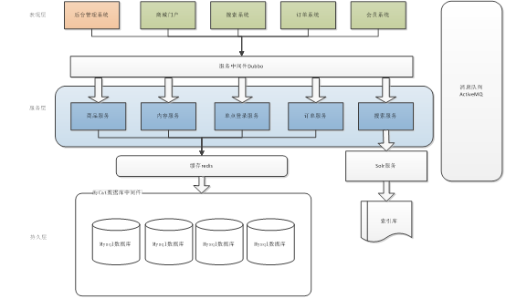
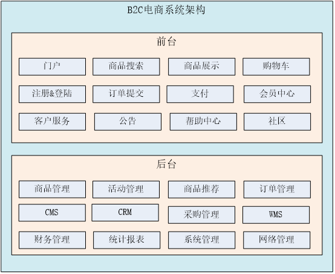

<p align="center">
  
</p>

<h1 align="center">淘淘商城</h1>

<p align="center">
  <a href="https://gitee.com/itxinfei/taotao-parent">
    
  </a>
  <a href="https://qm.qq.com/cgi-bin/qm/qr?k=9yLlyD1dRBL97xmBKw43zRt0-6xg8ohb&jump_from=webapi">
    
  </a>
  <a href="http://mail.qq.com/cgi-bin/qm_share?t=qm_mailme&email=f0hLSE9OTkdHTT8ODlEcEBI">
    
  </a>
  <a href="https://www.apache.org/licenses/LICENSE-2.0">
    
  </a>
</p>

<p align="center">
  
  
  
  
  
  
</p>

淘淘商城是一个基于 **Dubbo + Spring + MyBatis** 的分布式 B2C 电商平台，提供完整的商品管理、搜索、购物车、订单、单点登录等功能。适合作为 Java 分布式架构的学习案例和中小型电商项目的基础框架。

> 📚 **培训教学文档**（从零学习本项目的完整系列）：
> - [docs/README.md](docs/README.md) —— 学习路线与文档导航
> - [docs/01-项目介绍与系统架构.md](docs/01-项目介绍与系统架构.md) —— 架构与模块划分
> - [docs/02-环境搭建与项目部署.md](docs/02-环境搭建与项目部署.md) —— 环境搭建与部署
> - [docs/03-核心模块业务讲解.md](docs/03-核心模块业务讲解.md) —— 六大核心业务链路
> - [docs/04-关键技术点原理与实践.md](docs/04-关键技术点原理与实践.md) —— Dubbo/Redis/Solr/MQ 原理
> - [docs/05-二次开发指南与常见问题.md](docs/05-二次开发指南与常见问题.md) —— 二次开发与 FAQ
> - [docs/06-数据库设计详解.md](docs/06-数据库设计详解.md) —— 11 张核心表与设计思想

---

## 1. 功能特性

| 模块 | 核心功能 |
|------|----------|
| 后台管理 | 商品管理、类目管理、内容发布、规格参数、订单处理 |
| 门户网站 | 首页展示、商品检索、商品详情、购物车、下单结算 |
| 单点登录 | 跨系统登录态管理 |
| 搜索服务 | 基于 Solr 的商品全文检索 |
| 内容管理 | 广告位、分类内容的动态发布 |

---

## 2. 系统架构

<p align="center">
  
  <br/>
  <em>系统架构图</em>
</p>

<p align="center">
  
  <br/>
  <em>功能模块总览</em>
</p>

### 2.1 服务调用关系

```
浏览器
  │
  ├── taotao-manager-web  (后台管理，8081)
  ├── taotao-portal-web   (门户网站，8082)
  ├── taotao-search-web   (搜索前端，8085)
  ├── taotao-item-web     (商品详情，8086)
  ├── taotao-sso-web      (SSO前端，8088)
  ├── taotao-cart-web     (购物车，8089)
  └── taotao-order-web    (订单前端，8091)
          │  Dubbo RPC（经 ZooKeeper 注册中心）
          ▼
  ├── taotao-manager-service  (20880)  商品/类目/规格
  ├── taotao-content-service  (20881)  内容管理
  ├── taotao-search-service   (20882)  搜索服务
  ├── taotao-sso-service      (20883)  单点登录
  └── taotao-order-service    (20884)  订单服务
          │
          ▼
  MySQL ─ Redis ─ Solr ─ ActiveMQ ─ FastDFS
```

### 2.2 外部依赖

| 中间件 | 用途 |
|--------|------|
| ZooKeeper | Dubbo 服务注册与发现 |
| Redis | 缓存、Session、订单号生成 |
| Solr | 商品全文检索索引库 |
| ActiveMQ | 商品变更消息通知（索引同步、页面静态化） |
| FastDFS | 商品图片存储 |
| MySQL | 业务数据持久化 |

---

## 3. 技术栈

<p align="center">
  
  
  
</p>

| 技术 | 版本 | 用途 |
|------|------|------|
| Spring Framework | 4.2.4 | 核心框架 |
| Spring MVC | 4.2.4 | Web MVC 框架 |
| MyBatis | 3.2.8 | 持久层框架 |
| Dubbo | 2.5.3 | 分布式服务治理 |
| ZooKeeper | 3.4.7 | 服务注册与发现 |
| Redis | 3.0+ | 分布式缓存 |
| Solr | 4.10.3 | 全文搜索引擎 |
| ActiveMQ | 5.11.2 | 消息中间件 |
| FastDFS | 5.0+ | 分布式文件存储 |
| FreeMarker | 2.3.23 | 页面静态化 |
| Druid | 1.0.9 | 数据库连接池 |
| Quartz | 2.2.2 | 任务调度 |

---

## 4. 快速开始

### 4.1 环境准备

| 类型 | 软件 | 版本要求 |
|------|------|----------|
| 必装 | JDK | 1.7+（推荐 1.8） |
| 必装 | Maven | 3.2+ |
| 必装 | MySQL | 5.7+ |
| 必装 | Tomcat | 7.0+ |
| 可选 | Redis | 3.0+（缓存服务） |
| 可选 | ZooKeeper | 3.4+（Dubbo 注册中心） |
| 可选 | Solr | 4.10+（搜索服务） |
| 可选 | ActiveMQ | 5.11+（消息队列） |
| 可选 | FastDFS | 5.0+（文件存储） |

### 4.2 初始化数据库

```bash
# 创建数据库
mysql -u root -p -e "CREATE DATABASE taotao CHARACTER SET utf8 COLLATE utf8_general_ci;"

# 导入SQL脚本
mysql -u root -p taotao < Doc/taotao.sql
```

### 4.3 配置数据源

编辑各 `service` 模块下的 `src/main/resources/properties/db.properties`：

```properties
jdbc.driver=com.mysql.jdbc.Driver
jdbc.url=jdbc:mysql://localhost:3306/taotao?characterEncoding=utf-8
jdbc.username=root
jdbc.password=your_password
```

### 4.4 编译项目

```bash
# 先安装父 POM
mvn install -N

# 编译所有模块（跳过测试）
mvn clean install -DskipTests

# 仅编译验证（不打包）
mvn compile test-compile
```

### 4.5 部署运行

#### 4.5.1 方式一：Maven Tomcat 插件（推荐）

```bash
# 终端 1 - 后台管理服务（Dubbo 20880）
cd taotao-manager/taotao-manager-service && mvn tomcat7:run

# 终端 2 - 后台管理 Web（8081）
cd taotao-manager-web && mvn tomcat7:run

# 终端 3 - 门户网站（8082）
cd taotao-portal-web && mvn tomcat7:run
```

#### 4.5.2 方式二：独立 Tomcat

将各模块 `target/*.war` 复制到 Tomcat `webapps` 目录，按启动顺序启动。详见 [INSTALL.md](INSTALL.md)。

### 4.6 启动顺序与端口

> **注意**：`service` 模块使用 Dubbo 协议端口（用于 RPC 通信），`web` 模块使用 Tomcat 端口（用于 HTTP 访问）。

| 顺序 | 模块 | 端口 | 类型 | 说明 |
|------|------|------|------|------|
| 1 | taotao-manager-service | 20880 | Dubbo | 商品/类目/规格服务 |
| 2 | taotao-content-service | 20881 | Dubbo | 内容服务 |
| 3 | taotao-search-service | 20882 | Dubbo | 搜索服务 |
| 4 | taotao-sso-service | 20883 | Dubbo | 单点登录服务 |
| 5 | taotao-order-service | 20884 | Dubbo | 订单服务 |
| 6 | taotao-manager-web | 8081 | HTTP | 后台管理 |
| 7 | taotao-portal-web | 8082 | HTTP | 门户网站 |
| 8 | taotao-search-web | 8085 | HTTP | 搜索前端 |
| 9 | taotao-item-web | 8086 | HTTP | 商品详情 |
| 10 | taotao-sso-web | 8088 | HTTP | SSO 前端 |
| 11 | taotao-cart-web | 8089 | HTTP | 购物车 |
| 12 | taotao-order-web | 8091 | HTTP | 订单前端 |

---

## 5. 项目结构

```
taotao-parent
├── Doc/                              # 项目文档与资源
│   ├── taotao.sql                    # 数据库初始化脚本
│   ├── 系统架构.png                   # 架构图
│   ├── 功能列表.png                   # 功能清单
│   └── logo.png                      # Logo
│
├── taotao-common/                    # [工具层] 通用工具类 & POJO
│
├── taotao-manager/                   # [服务层] 后台管理
│   ├── taotao-manager-dao/           # 数据访问层 (Mapper)
│   ├── taotao-manager-pojo/          # 数据模型
│   ├── taotao-manager-interface/     # Dubbo 接口定义
│   └── taotao-manager-service/       # Dubbo 服务实现
│
├── taotao-manager-web/               # [Web层] 后台管理系统
├── taotao-portal-web/                # [Web层] 门户网站
├── taotao-search-web/                # [Web层] 搜索前端
├── taotao-item-web/                  # [Web层] 商品详情
├── taotao-sso-web/                   # [Web层] 登录/注册
├── taotao-cart-web/                  # [Web层] 购物车
├── taotao-order-web/                 # [Web层] 订单前端
│
├── taotao-content/                   # [服务层] 内容管理
│   ├── taotao-content-interface/
│   └── taotao-content-service/
│
├── taotao-search/                    # [服务层] 搜索服务
│   ├── taotao-search-interface/
│   └── taotao-search-service/
│
├── taotao-sso/                       # [服务层] 单点登录
│   ├── taotao-sso-interface/
│   └── taotao-sso-service/
│
└── taotao-order/                     # [服务层] 订单服务
    ├── taotao-order-interface/
    └── taotao-order-service/
```

---

## 6. 访问地址

| 模块 | 地址 |
|------|------|
| 后台管理 | [http://localhost:8081](http://localhost:8081) |
| 门户网站 | [http://localhost:8082](http://localhost:8082) |
| 搜索页面 | [http://localhost:8085](http://localhost:8085) |
| 商品详情 | [http://localhost:8086](http://localhost:8086) |
| SSO 登录 | [http://localhost:8088](http://localhost:8088) |
| 购物车 | [http://localhost:8089](http://localhost:8089) |
| 订单中心 | [http://localhost:8091](http://localhost:8091) |

---

## 7. 配置说明

### 7.1 外部服务

| 服务 | 默认地址 | 配置位置 |
|------|----------|----------|
| MySQL | `localhost:3306` | `properties/db.properties`（各 service 模块） |
| Redis | `172.168.20.221:6379` | `spring/applicationContext-jedis.xml`（各 service 模块） |
| ZooKeeper | `172.168.20.221:2181` | spring 配置文件（各 web/service 模块） |
| Solr | `http://172.168.20.221:8983/solr/collection1` | `spring/applicationContext-solr.xml`（search-service） |
| ActiveMQ | `tcp://172.168.20.221:61616` | `spring/applicationContext-activemq.xml`（manager/search-service） |
| FastDFS | `172.168.20.221:22122` | `resource/client.conf`（manager-web） |

若在本地运行（无外部服务），将所有地址改为 `localhost`。

### 7.2 业务配置

| 配置项 | 说明 | 配置位置 |
|--------|------|----------|
| 商品缓存过期时间 | `ITEM_EXPIRE=86400`（秒） | `resource.properties`（manager-service） |
| 静态页面输出路径 | `HTML_OUT_PATH` | `resource.properties`（item-web） |
| 图片服务器地址 | `IMAGE_SERVER_URL` | `resource.properties`（manager-web） |
| 购物车 Cookie Key | `CART_KEY=TT_CART` | `resource.properties`（cart/order-web） |
| 登录 Token Key | `TOKEN_KEY=TT_TOKEN` | `resource.properties`（order/sso-web） |
| 搜索每页条数 | `SEARCH_RESULT_ROWS=60` | `resource.properties`（search-web） |
| 邮件告警凭据 | `mail.from` / `mail.authCode` / `mail.to` | 系统属性或环境变量（search-web） |

---

## 8. 部署与运维

### 8.1 部署方式

- **本地开发**：Maven Tomcat 插件或独立 Tomcat，详见 [INSTALL.md](INSTALL.md)
- **Docker 部署**：中间件容器化部署脚本，详见 [Docker配置.md](Docker配置.md)
- **变更记录**：各版本变更，详见 [CHANGELOG.md](CHANGELOG.md)

### 8.2 日志

各模块日志由 log4j 输出到 `${catalina.home}/logs/`，分为：

| 日志文件 | 级别 | 内容 |
|----------|------|------|
| `taotao-xxx.log` | INFO | 常规业务日志 |
| `taotao-xxx-error.log` | ERROR | 错误日志（独立文件） |

### 8.3 常见运维操作

```bash
# 检查服务端口占用
netstat -ano | findstr :8081          # Windows
netstat -tlnp | grep -E "8081|20880"  # Linux

# 查看 Dubbo 服务是否注册成功（需安装 zookeeper 客户端）
zkCli.sh -server localhost:2181
ls /dubbo

# 查看 Solr 索引
curl "http://localhost:8983/solr/collection1/select?q=*:*"

# 检查 Redis 缓存
redis-cli -h localhost keys "ITEM_INFO*"
```

---

## 9. 常见问题

<details>
<summary><b>Maven 编译失败</b></summary>

**原因**：依赖下载失败或版本冲突

```bash
mvn clean install -U -DskipTests
```

</details>

<details>
<summary><b>服务无法启动</b></summary>

**原因**：端口被占用或外部服务未启动

```bash
# 检查端口占用
netstat -ano | findstr :8081

# 启动外部服务
redis-server
zkServer.sh start
solr start
activemq start
```

</details>

<details>
<summary><b>数据库连接失败</b></summary>

**原因**：配置错误或 MySQL 未启动

```bash
net start mysql
mysql -u root -p taotao
```

</details>

<details>
<summary><b>Dubbo 服务找不到（No provider）</b></summary>

**原因**：service 模块未启动或 ZooKeeper 不可达

1. 确认 5 个 service 模块按顺序启动完成
2. 确认 `dubbo:registry` 的 ZooKeeper 地址正确
3. 确认各 web 模块 `dubbo:reference` 接口与 service 发布的接口一致
4. 查看 service 模块日志确认是否注册成功

</details>

<details>
<summary><b>图片上传失败</b></summary>

**原因**：FastDFS 未启动或 `client.conf` 配置错误

1. 确认 FastDFS tracker/storage 已启动
2. 确认 `resource/client.conf` 中 tracker 地址正确
3. 邮件告警需配置 `mail.from`、`mail.authCode`、`mail.to` 系统属性或环境变量

</details>

---

## 10. 界面预览

| 页面 | 截图 |
|------|------|
| 登录页面 |  |
| 后台管理 |  |
| 商品搜索 |  |

---

## 11. 贡献

欢迎提交 Issue 和 Pull Request！请阅读 [CONTRIBUTING.md](CONTRIBUTING.md)。

## 12. 许可证

本项目基于 **Apache License 2.0** 开源，详见 [LICENSE](LICENSE)。

> 淘淘商城已完结，部分技术可能已过时，适合作为学习和参考项目。
