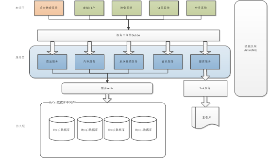

# 01 项目介绍与系统架构

> 学习目标：了解淘淘商城是什么、为什么这样设计、模块如何划分、技术如何选型。

## 1. 项目背景

淘淘商城是一个 **B2C 电商平台**，实现了从"商品上架"到"用户下单"的完整电商闭环。项目采用 **Dubbo + Spring + MyBatis** 的经典分布式架构，是学习 Java 分布式开发的典型教学案例。

### 1.1 为什么选择它来教学

| 特点 | 说明 |
|------|------|
| 业务完整 | 覆盖商品、搜索、购物车、订单、登录、内容六大电商核心业务 |
| 技术经典 | 使用 2015~2018 年主流分布式技术栈，原理至今通用 |
| 规模适中 | 12 个运行模块，代码量约 1 万行，适合通读 |
| 层次分明 | Web 层 / Service 层 / 中间件层清晰分层 |
| 文档配套 | 本教学系列 + README + INSTALL 全覆盖 |

### 1.2 与单体电商的区别

| 对比项 | 单体电商（如单 Tomcat 商城） | 分布式商城（本项目） |
|--------|------------------------------|----------------------|
| 部署 | 一个 War 包 | 12 个独立模块 |
| 数据库 | 单库直连 | 各服务独立连库（逻辑单库） |
| 服务通信 | 本地方法调用 | Dubbo RPC 远程调用 |
| 注册中心 | 无 | ZooKeeper |
| 缓存 | 可选 | Redis 必选（Session、热点数据） |
| 搜索 | SQL LIKE | Solr 全文检索 |
| 异步 | 无 | ActiveMQ 消息队列 |
| 文件存储 | 本地磁盘 | FastDFS 分布式文件系统 |

## 2. 总体架构

### 2.1 架构图

<p align="center">
  
</p>

### 2.2 分层说明

```
┌─────────────────────────────────────────────────────────┐
│                       浏览器（用户）                       │
├─────────────────────────────────────────────────────────┤
│  Web 层（7 个）：接收请求、渲染页面、调用远程服务            │
│   manager-web / portal-web / search-web / item-web       │
│   sso-web / cart-web / order-web                         │
├─────────────────────────────────────────────────────────┤
│  Dubbo RPC（经 ZooKeeper 注册与发现）                     │
├─────────────────────────────────────────────────────────┤
│  Service 层（5 个）：业务逻辑、事务、缓存、消息             │
│   manager-service / content-service / search-service     │
│   sso-service / order-service                            │
├─────────────────────────────────────────────────────────┤
│  基础设施层：MySQL / Redis / Solr / ActiveMQ / FastDFS    │
└─────────────────────────────────────────────────────────┘
```

### 2.3 一次完整请求的旅程（以"搜索手机"为例）

```
1. 用户在门户首页搜索框输入"手机"，点击搜索
2. 浏览器请求 taotao-portal-web 的 /index.html
   （门户首页通过 Dubbo 调用 content-service 拉取广告位内容）
3. 门户页面提交搜索表单到 taotao-search-web /search?q=手机
4. search-web 通过 Dubbo 调用 search-service
5. search-service 组装 SolrQuery，调用 searchDao 查询 Solr 索引库
6. Solr 返回文档列表，search-service 封装 SearchResult 返回
7. search-web 渲染 JSP，把结果（标题、价格、图片、高亮）展示给用户
```

## 3. 模块划分详解

### 3.1 Web 层（7 个）

| 模块 | 端口 | 职责 | 关键页面 |
|------|------|------|----------|
| taotao-manager-web | 8081 | 后台管理：商品/类目/内容/订单管理 | item-list、content |
| taotao-portal-web | 8082 | 门户首页、导航、用户中心入口 | index |
| taotao-search-web | 8085 | 搜索结果页 | search |
| taotao-item-web | 8086 | 商品详情页 + FreeMarker 静态化 | item |
| taotao-sso-web | 8088 | 登录 / 注册页 | login、register |
| taotao-cart-web | 8089 | 购物车 | cart |
| taotao-order-web | 8091 | 订单确认、订单列表、后台订单管理 | order-cart、success |

> 为什么 Web 层要拆这么多？—— 每个 Web 模块独立部署、独立演进，是"面向服务架构"的体现；
> 也是教学上便于按业务模块分人开发的典型拆法。

### 3.2 Service 层（5 个）

| 模块 | Dubbo 端口 | 暴露的接口 | 说明 |
|------|-----------|------------|------|
| taotao-manager-service | 20880 | ItemService、ItemCatService、ItemParamService、ItemParamItemService | 商品核心服务 |
| taotao-content-service | 20881 | ContentService、ContentCategoryService | 内容/广告服务 |
| taotao-search-service | 20882 | SearchService、SearchItemService | 搜索服务 |
| taotao-sso-service | 20883 | UserService | 用户与登录服务 |
| taotao-order-service | 20884 | OrderService | 订单服务 |

> Service 层内部通常再分：interface（接口，供消费者依赖）、service（实现）、dao（Mapper）、pojo（实体）。

### 3.3 通用模块

| 模块 | 职责 |
|------|------|
| taotao-common | JsonUtils、CookieUtils、IDUtils 等工具类；TaotaoResult、EasyUI 分页结果等公共 POJO |
| taotao-manager-dao | 全部 MyBatis Mapper 接口与 XML（订单、用户等表的 Mapper 也在这里） |
| taotao-manager-pojo | 全部数据库实体（TbItem、TbUser、TbOrder…）与 Example 查询对象 |

## 4. 技术选型与理由

| 技术 | 版本 | 解决什么问题 | 教学要点 |
|------|------|--------------|----------|
| Spring / Spring MVC | 4.2.4 | IoC 容器、MVC 分层 | 注解配置、AOP 事务 |
| MyBatis | 3.2.8 | ORM 持久化 | Mapper XML、动态 SQL |
| Dubbo | 2.5.3 | 分布式服务调用 | RPC、注册中心、负载均衡 |
| ZooKeeper | 3.4.7 | 服务注册与发现 | 分布式协调、节点监听 |
| Redis | 3.0+ | 缓存、Session、ID 生成 | 缓存策略、过期、incr |
| Solr | 4.10.3 | 全文检索 | 索引、分词、高亮 |
| ActiveMQ | 5.11.2 | 异步解耦 | 队列、主题、消息监听 |
| FastDFS | 5.0+ | 分布式文件存储 | Tracker/Storage |
| FreeMarker | 2.3.23 | 页面静态化 | 模板引擎 |
| Druid | 1.0.9 | 数据库连接池 | 监控、SQL 审计 |
| Quartz | 2.2.2 | 定时任务 | 订单超时关闭 |
| PageHelper | 5.1.2 | 分页插件 | 拦截器原理 |
| Jedis | 2.9.0 | Redis Java 客户端 | 连接池 |

## 5. 核心设计思想（重点）

### 5.1 面向接口 + Dubbo 服务治理

- **接口下沉**：接口定义在 `*-interface` 模块，Service 实现它，Web 依赖它 —— 实现与调用方解耦
- **服务发现**：Service 启动时向 ZooKeeper 注册，Web 启动时从 ZooKeeper 订阅 —— 无需硬编码 IP
- **负载均衡**：Dubbo 默认随机负载均衡，多个 Provider 自动分摊请求

### 5.2 缓存优先（Redis）

- 热点数据（商品信息、广告内容）先查缓存，未命中再查库并回填
- 写入/更新/删除时主动清理缓存，保证一致性
- 用 Redis 的 `incr` 生成分布式自增订单号

### 5.3 异步解耦（ActiveMQ）

商品上架后：
```
manager-service 写库成功
        │
        ▼
发送消息到 item-add-topic 主题
        │
        ├──► search-service 监听 → 增量更新 Solr 索引
        └──► item-web 监听 → 用 FreeMarker 生成商品静态页
```
好处：写库是同步的，索引与静态化是异步的，用户无感知、系统不阻塞。

### 5.4 面向场景的存储选型

| 数据 | 存储 | 原因 |
|------|------|------|
| 商品/订单等业务数据 | MySQL | 强一致、事务 |
| 商品描述/富文本 | MySQL TEXT | 简单可靠 |
| 商品检索 | Solr | 分词 + 相关性排序 |
| 购物车（未登录） | Cookie | 无状态、轻量 |
| 购物车（已登录） | Redis Hash | 跨设备同步 |
| 用户 Session | Redis | 分布式会话共享 |
| 图片 | FastDFS | 海量小文件、横向扩展 |

## 6. 数据流总览

```
商品上架：manager-web → manager-service → MySQL（商品+描述）
                                  └→ ActiveMQ → search-service → Solr
                                            └→ item-web → FreeMarker 静态页
搜索商品：portal/search-web → search-service → Solr
用户登录：sso-web → sso-service → MySQL 校验 → Redis 存 Token → Cookie
加购物车：cart-web → Cookie / Redis
下订单：order-web → order-service → MySQL（订单+明细+物流）
                                     └→ Redis incr 生成订单号
超时关单：order-service 内 Quartz 定时扫描 → 更新状态
```

## 7. 思考题

1. 为什么 Web 层要分成 7 个模块？如果都合并在一个工程里有什么问题？
2. Dubbo 的 Provider 和 Consumer 是如何互相发现的？
3. 为什么商品搜索不用 MySQL 的 `LIKE '%手机%'`，而要用 Solr？
4. 商品上架后，如果 ActiveMQ 挂了，会发生什么？如何保证最终一致？
5. 购物车为什么设计成"未登录存 Cookie、登录存 Redis"两种模式？

---

> 下一篇：[02 环境搭建与项目部署](02-环境搭建与项目部署.md)
